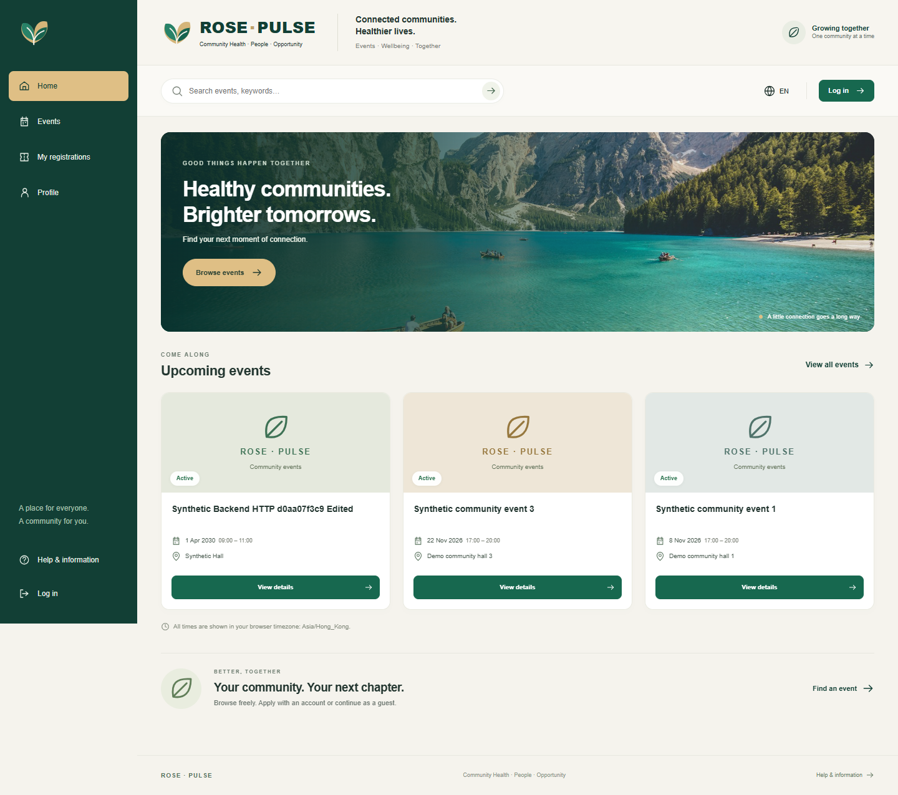
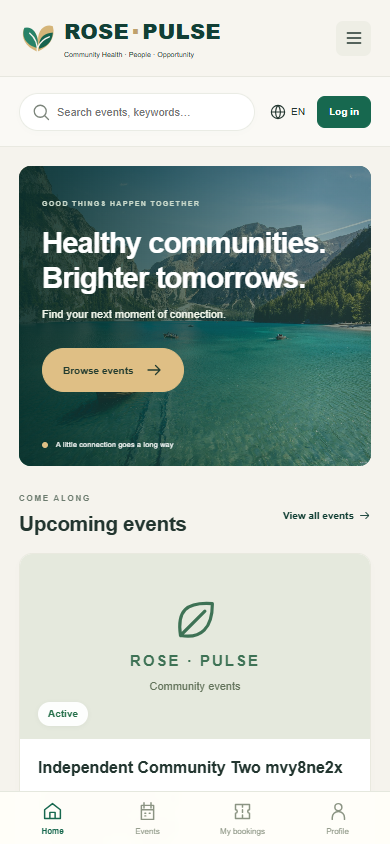

# ROSE PULSE V2 — bounded independent local acceptance

Run `20261102-032509`, 2026-11-02 Asia/Hong_Kong. Independent verdict: **ACCEPT_BOUNDED_LOCAL_DEMO**. Native execution: **PASS_BOUNDED_BROWSER_API_DB / LOCAL_VERIFIED**, with known limitations and no unresolved blocking finding in the reviewed scope. This is an independent agent review and native local execution, not team approval, comprehensive Security/UAT, CI success or merge authorization.

The independent reviewer used a fresh agent context and fixed frontend `6ddb485a28f6d94230481ce14db45b721c63ca00`.
The backend is unchanged PR40 `dcbdf47ed8e4d9b816676df97aaa80015c9e1928`. React product source was frozen at `a558074fd5474ada6244335828f7c5869102a03c`; the tested commit adds only shared documentation. The final delivery adds only this acceptance summary, two sanitized screenshots and document metadata. The external release receipt proves the product bytes are unchanged from the tested commit; final full delivery SHA is in PR55 and that receipt, avoiding a self-referential commit hash.

Runtime: Windows, Node24.14.0, Python3.14, installed native Chrome156.0.8078.74 via Playwright, PostgreSQL17.11. React5201 → reviewed proxy5202 → Backend8026 → dedicated PostgreSQL5437. App DB role is non-superuser; all services bind loopback. Database `nu_rose_pulse_20261102_032509` contains synthetic data only. This is separate from original Demo databases.

## Actual results and commands

| Layer / command | Result and evidence boundary |
|---|---|
| React `npm ci` | Final exit0; 101 packages installed. Initial Windows native-binding EPERM retained. Only the owned Vite process was stopped to release the lock. |
| React `npm test` | Exit0, 31/31 controlled component/adapter checks: 18 service and 13 React workflow tests. |
| React `npm run build` | Exit0; production bundle built. Built-preview HTTP/assets/proxy smoke also returned200. |
| Legacy `node --test frontend/dev-server.test.mjs frontend/live/tests/*.test.mjs` with explicit shell expansion | Exit0, 239/239; no legacy source/test changes. |
| Backend `python -B -m pytest -q tests -p no:cacheprovider --basetemp <isolated cache>` with private native opt-in | Exit0, 29 PASS: 26 ASGI/SQLite and3 native PostgreSQL uniqueness/race/rollback checks;6 deprecation warnings retained. |
| `python -B backend_verify.py http` | Exit0, 38 direct HTTP/native DB checks. These are separate from Browser acceptance. |
| `python -B backend_verify.py migration` | Exit0; dedicated original-shape migration first/repeat, wrong-DB refusal and duplicate refusal. Refusal subprocess exit1 is expected; existing rows/DDL remained unchanged. No old Demo or production migration claim. |
| `node evidence/independent/browser-e2e.cjs` with recorded resume stages | Final PASS_BOUNDED_BROWSER_API_DB; 106 observed HTTP responses. Ledger retains21 passing steps and3 harness failures across24 records, not106 independent test cases. |
| `node evidence/independent/browser-readonly-followup.cjs` | Final exit0, 23/23 assertions,17 actual GET responses, no POST/PATCH or page JS errors. First helper attempt is retained. |
| `python -B -X utf8 scripts/check_dev_control.py` | Exit0 on the full public tracked/untracked payload projection, excluding ignored node_modules/dist/private data. Final counts are in the command receipt. |
| Working/staged/committed `git diff --check` | Final exit0. Initial generated-register CRLF failure retained; normalized to LF without changing test expectations. |

## Native browser and database evidence

The reviewer exercised real API search/detail and full-page reload; Signup201 for two ordinary accounts; Login200 and identity; organizer image upload201, two Create201 responses, title-only PATCH200 and fresh readback preserving other fields. One participant applied to two different events with the same participant ID; another user and a mobile anonymous Guest each applied once. Guest sent no Authorization and has null participant user/registration actor. Online applications initially returned pending, not a confirmed place.

Organizer approval produced A-approved/B-waiting at capacity1. A's UI Cancel returned200; B became approved. Fresh activity quota was approved1/capacity1/waiting0. Own GET/Reload and organizer detail reflected server state. A new READ ONLY DB connection verified all4 new registration links; final dedicated DB counts were users7/events6/participants7/registrations8. Synthetic fixtures from earlier checks remain deliberately present.

Actual401/403/cross-user/duplicate400 negative checks preserved all4 table fingerprints. A real leader Login showed its supported profile and denied Create UI; backend role/owner authorization was checked independently of hidden buttons. Organizer-global registration review/approval is retained existing policy; event Edit and own Cancel have owner/actor restrictions. This is bounded authorization evidence, not a full penetration test.

Desktop1440 and mobile390 render without horizontal overflow or page JS errors. The read-only follow-up verified invalid stored-token401 cannot become Guest before explicit local Logout; closed mobile sidebar is inert and skipped by10 Tab traversals; tablet icons have names; keyword/pageSize survive Reload; uploaded image actually decodes from HTTP. Core UI states and screenshots were visually inspected against the supplied design direction.

## Review findings and original failures

Four P2 code-review findings at the first runnable commit were repaired before the tested commit: clearing an unuploaded image left submission disabled; completed operations lacked an explicit new-operation action; failed identity could lose its Guest-blocking latch after Session cleared a401 token; closed mobile/tablet navigation had focus/name defects. The repairs have targeted regression checks and independent reinspection. Unknown/pending writes remain locked and are never automatically resent.

Original failures remain in local evidence: component run25PASS/1FAIL repaired with proper search-input semantics; npm EPERM; backend launcher path normalization and an overlong synthetic username correctly rejected422; generated document register CRLF; three browser harness failures (ambiguous selector, Windows text decoding, assertion before asynchronous GET filled the edit form); one read-only follow-up helper clicked the backdrop center underneath the open drawer, then used the accessible Close navigation button. The browser failures were reconciled through observed HTTP/fresh DB before continuation; no uncertain business write was replayed. Initial and later results are not collapsed into “all tests passed”.

## Screenshots and retained evidence

These are actual local Chrome captures, not design mockups. Event titles/dates/locations are synthetic. Desktop is full-page; mobile is a390px viewport with mobile header and bottom navigation.

Full raw logs, failure captures, command ledgers, source/DB receipts and additional screenshots remain **local and unpublished** at `E:\NU_Local_Environment_20261014\rose-pulse-v2\20261102-032509`. This path is not a public evidence URL. The external `HANDOFF.json` and manifest bind commands and files to fixed SHAs. Credentials/private fixtures/HAR/raw sensitive SQL are excluded from Git. Public screenshots and this summary are the only uploaded acceptance artifacts.

## Remaining boundaries

- PR55 is a Draft stacked on PR40, base `fix/pr38-demo-readiness`; latest observed dev `480460b4a2b0902bb8256be02bc7c8d8f13ac6ee` does not include that repaired backend. No backend product changes or empty backend PR were made.
- W8 PR51/53/54 were merged only into module branches. Full replacements remove lifecycle/edit routes, change response/schema dependencies and omit file-upload authentication. They were not adopted; file-by-file reasons are in the contract/audit.
- English only; category shortcuts are honest keyword queries. Missing images use branded placeholders. No fabricated5000-case analytics, Offline Ready or full accessibility/security badge.
- Leader offline capture, PWA/IndexedDB/native SQLite, disconnected restart/replay/conflict/sync, Guest claim/read/cancel, mixed-pool policies, offer/accept/expiry, SMS/OCR, broader multilingual coverage, full Security/UAT, production deployment and old-database migration remain NOT_RUN or unsupported.
- Local Logout does not claim server token revocation. Backend determines statuses/quotas. Income code SYNTHETIC is a test value, not an approved business option.
- Mobile checks use actual Chrome viewport emulation, not physical-device certification. Unknown-write handling is source/component reviewed; a new native transport-fault or lost-response test was NOT_RUN.
- No service Stop/restart cycle was performed during the active acceptance run. Start/Status and an idempotent Start are recorded separately. No merge, force push, Issue/Board changes or teammate messages.
