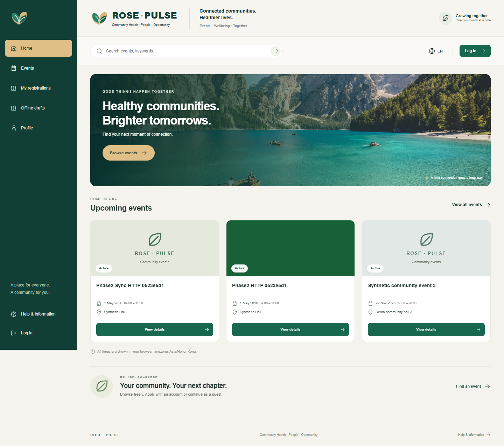
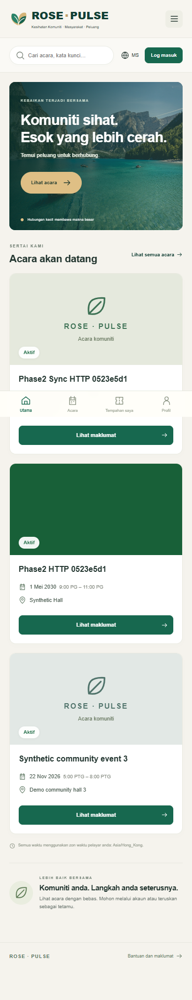

# Phase 2 bounded native acceptance

**ACCEPT_BOUNDED_NATIVE_SYNTHETIC_PHASE2**. The independent reviewer found no unresolved blocking finding in the reviewed local synthetic scope. This is not team acceptance, full Issue closure, production privacy approval, comprehensive Security/UAT or merge authorization. Draft PR56 depends on Draft PR57 and the existing38→40→55 parent stack.

Tested frontend `4f2bb20c1234ff1db0cfd6f8fc48fb25675f361e` and backend `54ab71d29852df26f17fb32317e405e5a48353ea`; migration `rose_phase2_20261102_v1`; contract `rose.offline-sync.v2`. Windows, installed Chrome, Python3.14.8, Node24.14.0 and native PostgreSQL17.11 (non-superuser role) were used through5205→5206→8028→5439. Public production assets, process/port identity and direct/proxy equality are in the [runtime binding](evidence/controller/runtime-binding.json). A later documentation-only delivery commit must preserve these runtime product bytes; final delivery heads are read back in PR metadata/local release receipt.

## Results and evidence layers

- Independent ledger:45 steps,42 PASS and3 retained first failures; zero JavaScript page errors;230 observed HTTP responses plus two successful backend sync responses deliberately discarded before reaching the browser.24 viewport captures had no horizontal overflow. Original failures and mixed-source applicability are in the [independent report](INDEPENDENT_REVIEW.md) and [machine-readable review](evidence/independent/ACCEPTANCE.json).
- Author React baseline77/77 and legacy/proxy241/241 passed at82b. Share repair17 targeted tests passed at2ccb; failure-readback repair24 targeted tests passed at4f2. These overlap and are not a single combined test count. Builds passed; the approximately525kB main-chunk advisory remains. Exact commands/exits/build hashes are in the three [frontend evidence records](PUBLIC_EVIDENCE_INDEX.json).
- Backend author groups36+8+1+1+3 cover49 unique cases across separate commands; postcommit4/6/3 runs are repeated subsets.71 real HTTP/DB checks, final11 read-only HTTP checks, native migration/rollback/concurrency and preserved RED results are in the [Backend matrix](evidence/backend/VALIDATION_MATRIX_BACKEND.json) and [command ledger](evidence/backend/COMMAND_LEDGER_BACKEND.json). The independent reviewer inspected raw race/migration evidence and source; those experiments were not all independently rerun.
- Evaluation tooling9/9 passed after two preserved peer-review counterexamples; independent mathematical review also passed. Real participants, subjective ratings and funder review remain NOT_RUN. [User-side package](evaluation/USER_STUDY.md), [observed synthetic subtask pilot](evaluation/PILOT_RESULTS.md), [funder package](evaluation/FUNDER_ASSESSMENT.md), [finite scalability results](evaluation/SCALABILITY.md).

| Gate | Result | Exact boundary |
|---|---|---|
|O01|PASS_BOUNDED_NATIVE|Original same batch/submission IDs replayed deliberately from separate real Chrome context with empty independent IndexedDB; exact original receipt and all nine table fingerprints unchanged. Physical cross-device test not run.|
|O02|PASS_BOUNDED_NATIVE_AND_SOURCE|Cached local actor could not send before fresh login; other organizer/normal user403, absent/invalid token401 for original receipt; private documents anonymous401 and foreign actors403. Backend role-lock counterexample reviewed from writer native RED/GREEN, not independently re-executed.|
|O03|PASS_BOUNDED_NATIVE|Two POSTs forwarded to actual backend, each committed and freshly read from native DB before discarding browser response. Original three recovered by GET only; separate fourth affected retest also GET-reconciled. No automatic resend.|
|O04|REVIEWED_AUTHOR_NATIVE_PLUS_INDEPENDENT_READONLY|Reviewed writer raw populated-legacy first/repeat migration hashes and injected-DDL rollback. Independent final native read-only check confirms nullable columns and additive tables. Independent migration execution NOT_RUN.|
|P01|PASS_BOUNDED_NATIVE|Installed production app shell tested with Chrome emulated offline and separately actual owned HTTP service processes absent; no API/uploads in cache. This is service-process isolation, not physical network/hotspot isolation.|
|P02|PASS_BOUNDED_NATIVE|Three synthetic UI drafts saved with5205/5206/8028 absent, reloaded and survived complete Chrome process exit/relaunch in persistent profile; no tab token, explicit local unlock, same IDs and data; PG5439 retained.|
|P03|PASS_BOUNDED_NATIVE|Manual send requires fresh same-actor login; immutable original batch persists; GET recovery completed without resend. Four distinct offline registrations across two batches.|
|P04|PASS_BOUNDED_NATIVE_AND_SOURCE|Persisted unknown state survived full Chrome restart before GET recovery. Fixed immediate failure-refresh path independently exercised with one new batch. Logout/account switch hides retained queue. Mid-flight process kill is controlled/source coverage only, not a native claim.|
|L01|PASS_BOUNDED_NATIVE|EN/MS home reload, actual Malay guest six-field submission201 with DB identity hash, My Registrations/Create/Edit/Offline translated views and mobile no-overflow. Formal Malay translator/NGO approval NOT_RUN.|
|W01|PASS_BOUNDED_NATIVE_AND_SOURCE|Actual UI upload three event images, Create, remove one/upload replacement/PATCH/reload and fresh DB exact three associations. Picker disabled at three; upper bounds inspected in source/controlled author tests.|
|W02|PASS_BOUNDED_NATIVE_AND_SOURCE|Actual UI upload three supporting documents, registration/readback associations, private authenticated UI download and negative actor access. Optional documents collapsed; no invented eligibility policy.|
|W03|PASS_BOUNDED_NATIVE|Original visible9 to current6 fields =33.3% reduction. Actual guest/accounted registrations persist omitted optional address/income/marriage/medical asNULL; repeated A on another event preserves participant identity.|
|W04|PASS_BOUNDED_NATIVE|Own event list, own registration index and registration analytics use actual API/native data. External NGO/funder identity/provider/notification integrations NOT_RUN.|
|R01|PASS_BOUNDED_NATIVE|Guest/account signup/login/application, owner gallery create/edit, organizer approve/waitlist, own cancellation with refill and organizer-owned cancellation passed on native API/PG. Final READ ONLY reconciliation confirms exact IDs/status/null fields.|

## Failures repaired without replaying uncertain writes

BE-R1 repaired stale-role cancellation during an event-lock wait; BE-R2 converts actual PostgreSQL deadlock rollback into controlled409 without a business retry. FE-R1 adds public detail sharing before application. FE-R2 refreshes IndexedDB-backed state after failed sync so durable needs_review exposes Reconcile immediately. The exact Malay wrapped-select locator failure was a harness issue; it required no product change. Initial native/controlled RED results remain in the source ledgers.

The original three offline applications were captured with actual HTTP services absent, survived whole Chrome restart and were later committed once with their response lost. Recovery used GET only. A fourth distinct synthetic application tested the repaired failure UI and was also GET-reconciled. Deliberate same-ID replay from another Chrome context added zero business effects; all nine table fingerprints stayed unchanged. The [fresh READ ONLY DB proof](evidence/independent/phase2-db-final.json) distinguishes persisted synchronization receipts from registration approval. Pending/synced never means a reserved place.

## Published subset and visual evidence

[Public evidence index with SHA256](PUBLIC_EVIDENCE_INDEX.json) identifies the selected metadata, source review and screenshots included in Git. Full raw logs, all failure screenshots, scripts and private browser fixtures remain under `E:\NU_Local_Environment_20261014\rose-pulse-phase2\20261102-050245`; this local Windows path is not a remote evidence link. Private credentials/profile/request bodies/raw SQL/HAR are not published. The final contract incorporates controller clarification of fingerprint version, request bounds, transaction409 and legacy-policy limits; the earlier author contract is retained locally.

These home captures are from82b; source review confirms the two later repairs leave home/styles unchanged. They show the supplied green/gold/warm-neutral design direction, not a pixel-perfect or certified-accessibility claim.

## Remaining boundaries

Offline storage is unencrypted and **synthetic-only**. Physical iPhone/hotspot/two-device testing, real-user SEQ/SUS, qualified Malay/NGO approval, provider-backed SMS/OTP/notices,5000-user load, production SLA/ROI and deployment are NOT_RUN/BLOCKED_PROVIDER. Native mid-flight process kill before an unknown state persisted is not claimed; whole-browser restart and persisted-unknown recovery were actually tested. Flyer generation/promotion is not implemented; the asset manifest identifies reused licensed imagery and placeholders. No OCR workflow was restored.

The inherited organizer-global v1 registration policy remains; new owner-scoped v2 indexes do not remove it. Guest claim/read/cancel, mixed-pool policy, eligibility/support-document policy, production encryption/retention/backup and original Demo/production migrations remain separate work. [Integration order and conflicts](INTEGRATION.md) are recommendations only. No old PR mutation, merge, deployment, Issue/Board change, reviewer assignment or external messaging occurred.
